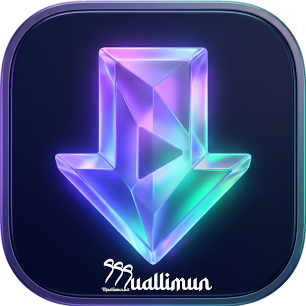
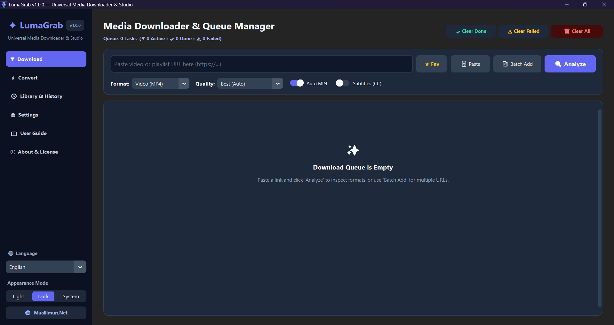
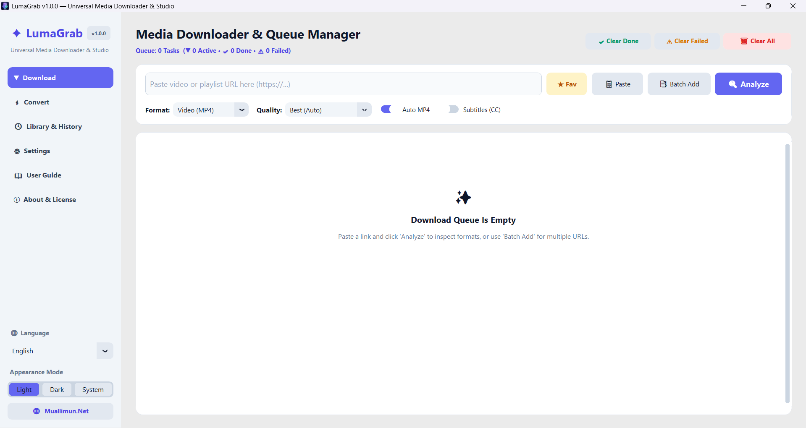

  

  # LumaGrab
  **Universal Media Downloader & Conversion Studio**

  
  
  [-0F172A?style=for-the-badge&logo=windows)](https://github.com/muallimun/LumaGrab/releases/latest)
  [-F59E0B?style=for-the-badge)](LICENSE.txt)

  🌐 **[Official Product Page (muallimun.net/LumaGrab)](https://muallimun.com/LumaGrab)** • 📦 **[Download Latest Version](https://github.com/muallimun/LumaGrab/releases/latest)** • 🐛 **[Report an Issue](https://github.com/muallimun/LumaGrab/issues)**

  *Available in 8 Languages: English • Türkçe • العربية • Русский • فارسی • हिन्दी • Français • Deutsch*

---

## ✨ Overview

**LumaGrab** is a fast, modern, distraction-free desktop media downloader and local FFmpeg conversion studio developed under the **Muallimun.Net** digital ecosystem. Designed with a clean interface and zero ads, it enables effortless downloading of high-resolution videos, playlists, audio tracks, and subtitles from hundreds of supported platforms.

### 🚀 Direct Download (Windows 10 / 11 — x64)

| Edition | Description | Direct Download |
| :--- | :--- | :--- |
| **💿 Standard Installer (Recommended)** | Full setup wizard with Start Menu & Desktop shortcuts, clean uninstaller, and automatic update support. | **[Download LumaGrab_Setup_v1.0.0.exe](https://github.com/muallimun/LumaGrab/releases/latest/download/LumaGrab_Setup_v1.0.0.exe)** |
| **🎒 Portable Edition (Single `.exe`)** | No installation required. Run directly from any folder or USB drive with FFmpeg & Deno built in. | **[Download LumaGrab_Portable_v1.0.0.exe](https://github.com/muallimun/LumaGrab/releases/latest/download/LumaGrab_Portable_v1.0.0.exe)** |

---

## 🖼️ Screenshots

  
  

---

## 🔥 Key Features

* **🎯 High-Resolution Video & Audio:** Download in **8K, 4K (2160p), 2K, 1080p Full HD**, or extract studio-grade audio in **MP3 (320 kbps), M4A, and FLAC** with embedded cover art and metadata.
* **📂 Smart Playlist & Batch Engine:** Automatically organizes playlists into dedicated, numbered subfolders (`01 - ...`, `02 - ...`) and supports multi-URL batch queuing.
* **🎬 Auto-MP4 & Built-in FFmpeg Studio:** Seamlessly merges separate high-res video/audio streams into universally compatible **H.264/MP4** containers, plus includes a **Local Media Converter** tab for offline `.webm`, `.mkv`, `.mov`, and `.wav` files.
* **⏸️ Parallel Queue with Byte-Level Resume:** Download up to 5 streams simultaneously, pause anytime, and resume right where you left off without restarting.
* **💬 Subtitles & Browser Cookie Support:** Download `.srt` subtitles in multiple languages, optionally embed them into videos, and handle age-restricted or member-only content via local browser cookies.
* **🌍 Instant 8-Language Switching:** Real-time UI translation across **English, Turkish, Arabic, Russian, Persian, Hindi, French, and German** without restarting the app, paired with **Dark / Light / System** themes.
* **🔄 Built-in GitHub Update Center:** Checks official releases from `muallimun/LumaGrab` and downloads updates directly inside the application.

---

## 🇹🇷 Türkçe Özet

**LumaGrab**, **Muallimun.Net** çatısı altında geliştirilen reklamsız, hızlı ve modern bir masaüstü medya indirici ve yerel format dönüştürme stüdyosudur.
* **4K / 1080p Otomatik MP4 Birleştirme** ve kapak resimli **320 kbps MP3 / M4A / FLAC** ses ayıklama.
* **Oynatma Listesi (Playlist)** videolarını kendi klasörüne sıralı indirme ve **Toplu Bağlantı (Batch URL)** desteği.
* Yerleşik **FFmpeg Dönüştürücü**, **Altyazı (.srt) İndirme**, **Pano Bağlantı Algılayıcı** ve **8 Dilde Canlı Arayüz**.
* Resmi Tanıtım Sayfası: **[https://muallimun.com/LumaGrab](https://muallimun.com/LumaGrab)**

---

## 🛡️ Security & Windows SmartScreen Note

Because LumaGrab is distributed as independent freeware without a paid Microsoft EV certificate, Windows Defender SmartScreen may display an *"Unrecognized app"* prompt on first launch:
1. Click **More info** (*Ek bilgi*).
2. Click **Run anyway** (*Yine de çalıştır*).

All official binaries are built cleanly and distributed exclusively via `github.com/muallimun/LumaGrab` and `muallimun.net/LumaGrab`.

---

## 📜 License (Proprietary Freeware)

**LumaGrab** is **Freeware** (free for personal and educational use), **NOT open-source**.
* This repository serves as the **official public release, documentation, and issue-tracking hub**.
* Reverse engineering, decompiling, modifying, rebranding, or commercial redistribution of the binaries is strictly prohibited. See [LICENSE.txt](LICENSE.txt) for full terms.

  Copyright © 2026 <b>Muallimun.Net</b> — <a href="https://muallimun.com/LumaGrab">muallimun.net/LumaGrab</a>. All Rights Reserved.

